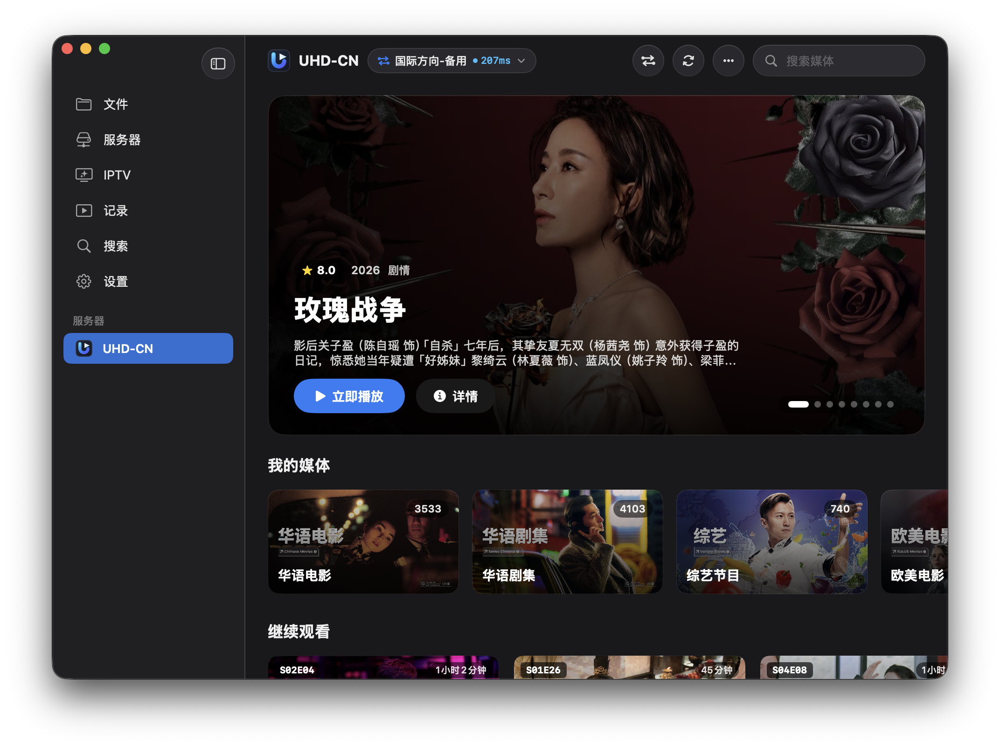
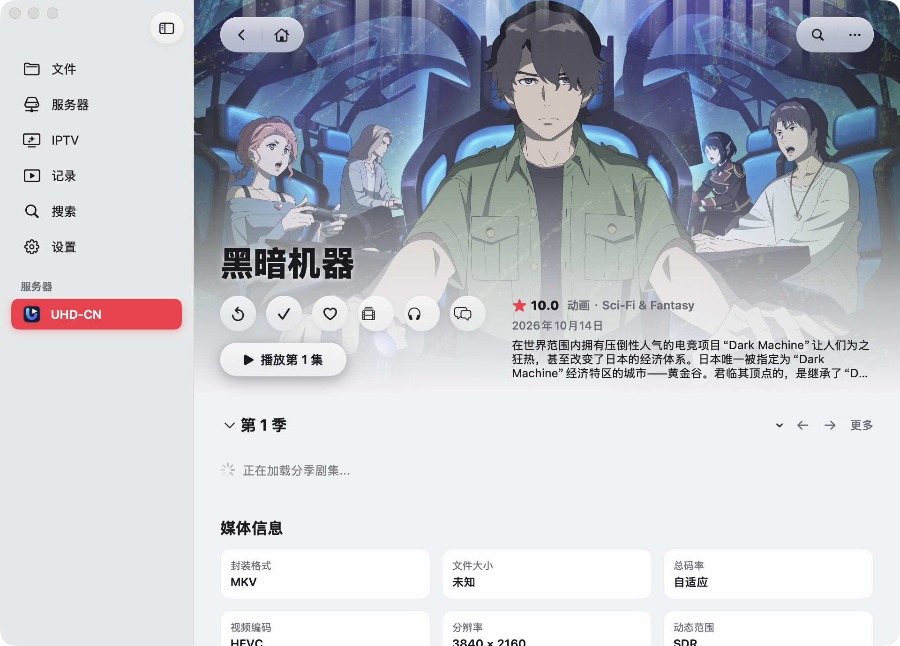

<p align="center">
  
</p>

<h1 align="center">Donby</h1>

<p align="center">
  原生 macOS Emby / Jellyfin / UHDNow 媒体播放器
</p>

<p align="center">
  <a href="https://github.com/DonJone/Donby/actions/workflows/build-dmg.yml"></a>
  <a href="https://github.com/DonJone/Donby/releases"></a>
  
  
  <a href="./LICENSE"></a>
</p>

<p align="center">
  
  <br />
  
</p>

## 特性

- **硬件解码与 HDR / EDR 渲染**：基于 `VideoToolbox` 硬件加速（含 `IOSurface` 10-bit 软解回退）与 `CAMetalLayer` 扩展线性 Display P3 16-bit 浮点管线，支持 Dolby Vision（Profile 5 / Profile 8 动态 RPU 映射）、HDR10、HLG 与 ITU-R BT.2390 色调映射。
- **音频时钟与多格式字幕**：采用 `AudioQueue` 硬件采样计数驱动音画同步，支持 TrueHD Atmos 等多声道音频下混；内置 `libass` 与蓝光 `PGS` 位图解码，支持内封/外挂 `ASS`、`SSA`、`SRT`、`WebVTT`、`PGS` 字幕实时切换与 SDR/HDR 统一纸白亮度校准。
- **Emby / Jellyfin / UHDNow 多源接入**：原生内嵌 UHDNow 官方品牌图标（支持明暗双色自适应）与节点识别；支持 [`emby_ext_domains`](https://github.com/uhdnow/emby_ext_domains)（`ServerDomains`）云端节点自动同步、并发延迟测速与在线切线；支持 302 原画直连、播放记录双向同步、默认码率版本偏好预设、剪贴板配置导入与 M3U 播放列表。
- **原生 macOS 桌面体验**：跟进 macOS 音乐 App（Apple Music）设计语言，采用羊脂玉润白底座、黑曜石雕塑倒角微高光主体、纯圆点轮播指示器与极简玻璃质感组件，适配亮暗双色主题、触控板双指手势滑动海报与无边框全屏播放。

## 安装与构建

### 下载安装

前往 [Releases](https://github.com/DonJone/Donby/releases) 下载最新 `Donby-<version>-macOS-arm64.dmg`，挂载后将 `Donby.app` 拖入 `Applications` 即可使用（应用包已内嵌所需运行时动态库）。

> 未经 Apple Developer ID 公证的构建在首次打开时若提示无法验证，可在终端执行一次：
> ```bash
> sudo xattr -rd com.apple.quarantine /Applications/Donby.app
> ```

### 从源码构建

环境要求：
- macOS 14.0+（Apple Silicon）
- Xcode Command Line Tools（Swift 5.10+ / Clang C++20）
- Rust 工具链（`cargo`）
- Homebrew 依赖库：

```bash
brew install ffmpeg libass
```

编译并生成独立运行的 `Donby.app`：

```bash
git clone https://github.com/DonJone/Donby.git
cd Donby
./build_app.sh
```

打包 `.dmg` 分发镜像（输出至 `dist/`）：

```bash
./scripts/package_dmg.sh
```

## 项目结构

```text
Donby/
├── .github/workflows/          # GitHub Actions 自动构建与 Release 工作流
├── KernelRust/                 # Rust 环形缓冲池与 Dolby Vision RPU 解析
├── Sources/
│   ├── DonbyKernelC/           # C++20 解封装、VideoToolbox 硬解、AudioQueue 时钟与字幕解码
│   ├── DonbyMetalRenderer/     # Metal HDR/EDR 着色器与 CVDisplayLink 渲染驱动
│   ├── DonbyCore/              # 核心数据模型、版本选择策略与剪贴板配置解析
│   ├── DonbyNetwork/           # Emby / Jellyfin / UHDNow API 与 302 直链解析
│   ├── DonbyStorage/           # Keychain 安全凭据存储
│   └── DonbyApp/               # macOS SwiftUI 界面与播放器交互组件
├── scripts/generate_icon.swift # macOS 应用图标生成脚本
├── scripts/bundle_dylibs.py    # 动态库依赖收敛与 @rpath 重写脚本
├── scripts/package_dmg.sh      # DMG 镜像打包与 SHA-256 校验生成脚本
├── build_kernel.sh             # 原生播放内核构建脚本
└── build_app.sh                # Donby.app 构建与签名脚本
```

## 致谢

- 底层媒体解封装、解码回退与字幕渲染基于 [FFmpeg](https://ffmpeg.org/) 与 [libass](https://github.com/libass/libass)，多节点同步扩展兼容 [uhdnow/emby_ext_domains](https://github.com/uhdnow/emby_ext_domains)。
- 部分界面交互与视觉细节参考并致敬了 Apple TV、SenPlayer 与 Infuse。

## License

Copyright © 2026 [DonJone](https://github.com/DonJone). Released under the [GNU AGPL-3.0 with Commons Clause v1.0](./LICENSE).
